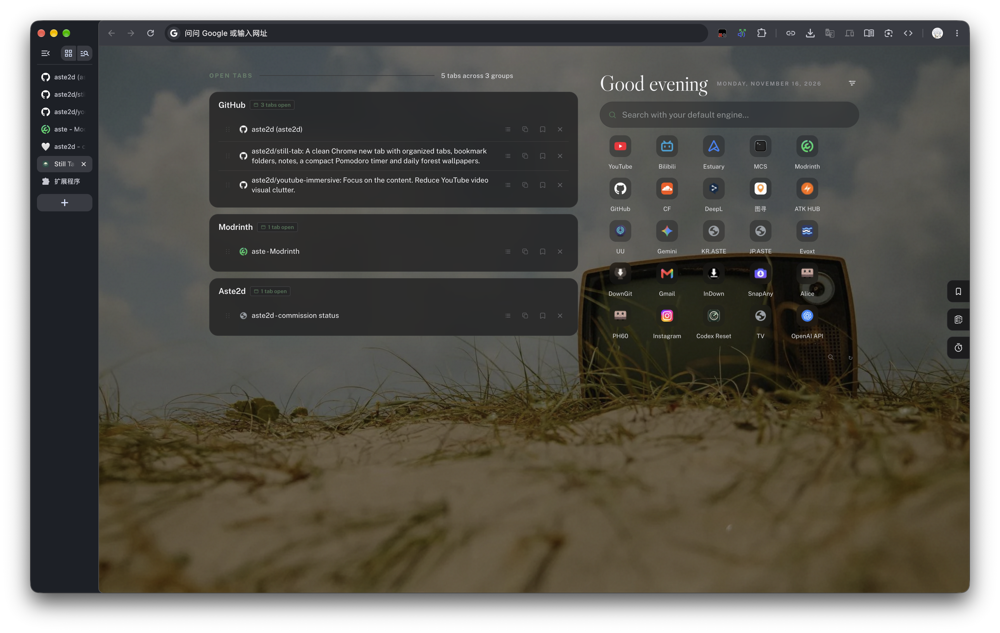

# Still Tab

[English](README.md) · [简体中文](docs/README.zh-CN.md) · [繁體中文](docs/README.zh-TW.md) · [日本語](docs/README.ja.md)

A clean new tab that stays out of your way. By [aste2d](https://github.com/aste2d/).

[Report an issue](https://github.com/aste2d/still-tab/issues) · [Privacy policy](https://astab-privacy.poodle11215.chatgpt.site)



## Install

[](https://chromewebstore.google.com/detail/still-tab/ifdkabkkiadgmdpbaijgcmcaeledkdci)

Requires **Chrome 134 or newer**. Select **Add to Chrome** and confirm. Open a new tab and keep the change if Chrome asks. Chrome updates the store version automatically.

## If you can't install from the Chrome Web Store

<details>
<summary>Manual installation from GitHub</summary>

1. Download `still-tab-VERSION.zip` from [GitHub Releases](https://github.com/aste2d/still-tab/releases/latest). For the latest development build, download the [source ZIP](https://github.com/aste2d/still-tab/archive/refs/heads/main.zip). Both can be loaded without a build step.
2. Extract the ZIP to a folder you plan to keep.
3. Open `chrome://extensions` and enable **Developer mode**.
4. Select **Load unpacked** and choose the folder that directly contains `manifest.json`.

To update a manually installed copy, extract the new release and copy its files into the **same folder**. Click **Reload** on the existing Still Tab extension (previously named astab), then refresh the new-tab page or open a new one. Reusing the same folder keeps the extension identity and local data. Uninstalling clears the extension’s local data. Chrome manages bookmarks separately. The store version uses a separate extension ID and does not automatically import data from an unpacked installation.

</details>

## Features

**Auto close extras is on by default.** Opening a new tab closes other new-tab pages across all windows, including pinned new-tab pages. Ordinary webpages stay open. To keep multiple new tabs, turn off this option in Still Tab’s settings.

- Open tabs are grouped by website. Drag the card or title text to reorder tabs. Each tab has a copy-title action.
- Bookmarks keep Chrome’s original order. Browse folders, go back up a level, or search across folders. **Show All Bookmarks** is off by default. When enabled, the section shows the remaining bookmark roots alongside the bookmark bar.
- The right side holds saved pages, to-dos, notes, and a collapsible Pomodoro timer with 25-minute focus sessions and 5- or 15-minute breaks. The timer supports pausing, resuming, and resetting.
- Daily discovery wallpaper is enabled by default. You can also choose from eight Unsplash forest photos, upload your own image, or use a solid color. Cached wallpaper stays available offline.
- Customize or randomize the five theme colors. **Default** restores the Sage palette.
- **Close group** and **Close all tabs** appear on hover. Confirm with a second click within five seconds, or cancel by moving away, pressing Escape, or taking another action.


## Privacy and permissions

Still Tab requires no account and has no ads, analytics, or developer-operated server. Tabs, bookmarks, saved pages, notes, and timer state are processed locally. Online wallpapers contact the image provider. Searches use Chrome’s default search engine, and links open their destinations normally.

The extension uses `tabs` to display and manage tabs, `bookmarks` to read bookmarks, `storage` to keep local data, `search` to use your default search engine, `favicon` to display site icons, and `alarms` to finish timers after the page closes.

The [privacy policy](https://astab-privacy.poodle11215.chatgpt.site) covers data handling, network connections, retention, and deletion. A copy is available under **About** in the extension.

## Development

Vanilla JavaScript, HTML and CSS. The following commands require Node.js 22 or newer.

```sh
npm test
npm run icons
npm run package
```

The packaging script currently requires macOS or Linux with `/usr/bin/zip`. It writes `release/still-tab-VERSION.zip` using an explicit allowlist. Tests, screenshots and development files are excluded from the installable ZIP. Downloading a release does not require these development tools.

`src/dashboard-runtime.js` preserves the original layout. `src/tabs-panel.js` and `src/notes-panel.js` handle their respective views. `src/bookmarks.js`, `src/wallpaper.js` and `src/pomodoro.js` implement the additional features. `src/forest-library.js` records the photo sources and credits.

## Credits and license

Based on [Tab Harbor](https://github.com/V-IOLE-T/tab-harbor), copyright © 2026 Han Zheng, under the included [MIT license](LICENSE). Changes and branding by aste2d. Public Sans and Libre Caslon Display retain their bundled SIL Open Font Licenses. Forest photographs are credited in `src/forest-library.js`. Daily discovery uses [Lorem Picsum](https://picsum.photos/).

Bookmark navigation references the group-local folder interaction in [Bonjourr](https://github.com/victrme/Bonjourr/blob/master/src/scripts/features/links/folders.ts) and [Chromium’s bookmark guidance](https://www.chromium.org/user-experience/bookmarks/). No third-party source was copied for this feature.
