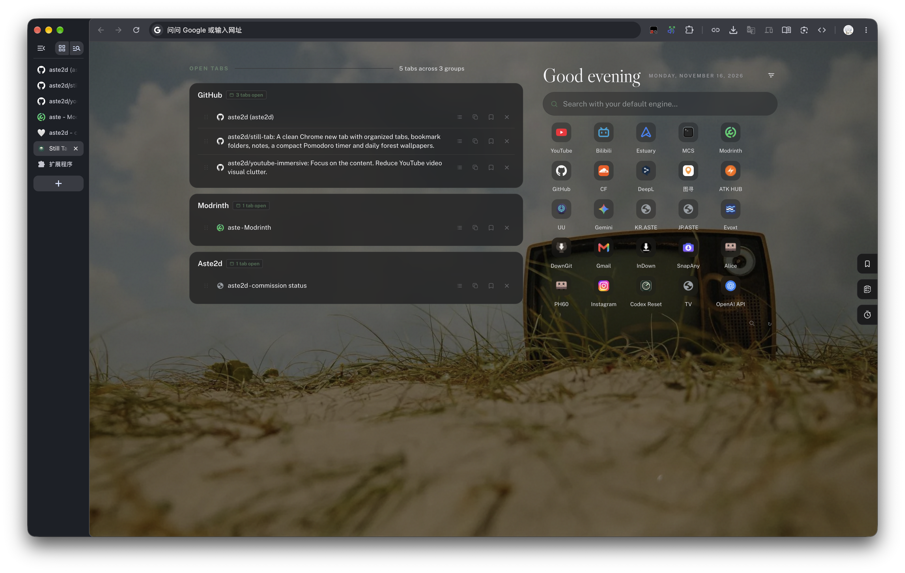

# Still Tab

[English](../README.md) · [简体中文](README.zh-CN.md) · [繁體中文](README.zh-TW.md) · [日本語](README.ja.md)

Chrome の新しいタブをすっきりとした作業スペースに。開いているタブを左側にまとめ、右側には検索、ブックマーク、タスク、メモ、ポモドーロタイマーを配置します。

[問題を報告](https://github.com/aste2d/still-tab/issues) · [プライバシーポリシー](https://astab-privacy.poodle11215.chatgpt.site)

## インストール

**Chrome 134 以降**が必要です。**Chrome に追加**を選び、インストールを確定します。新しいタブを開き、変更を維持するか確認されたら、維持する方を選びます。ストア版は Chrome が自動で更新します。

## Chrome ウェブストアからインストールできない場合

GitHub から手動でインストール

1. [GitHub Releases](https://github.com/aste2d/still-tab/releases/latest) から `still-tab-VERSION.zip` をダウンロードします。最新の開発版を使う場合は、[ソースコードの ZIP](https://github.com/aste2d/still-tab/archive/refs/heads/main.zip) をダウンロードします。どちらもビルドは不要です。
2. ZIP を今後も使うフォルダーに展開します。
3. `chrome://extensions` を開き、**デベロッパー モード**を有効にします。
4. **パッケージ化されていない拡張機能を読み込む**を選び、直下に `manifest.json` があるフォルダーを指定します。

手動インストール版を更新するには、新しいファイルを**元と同じフォルダー**に上書きします。既存の Still Tab（旧名 astab）で**再読み込み**をクリックし、新規タブページを読み込み直します。同じフォルダーを使うと拡張機能の ID とローカルデータを維持できます。拡張機能を削除すると、そのローカルデータも削除されます。Chrome のブックマークは別に管理されます。ストア版は拡張機能の ID が異なり、手動インストール版のローカルデータは自動で引き継がれません。

## 機能

**「余分な新しいタブを自動で閉じる」は初期設定で有効です。** 新しいタブを開くと、すべてのウィンドウで他の新規タブページが閉じます。固定した新規タブページも対象です。通常のウェブページは開いたままです。複数の新規タブページを残すには、Still Tab の設定でこの機能を無効にしてください。

- 開いているタブをサイトごとにまとめます。カードの余白やタイトルをドラッグして並べ替え、タブごとにタイトルをコピーできます。
- ブックマークは Chrome での順序を維持します。フォルダーの閲覧、上の階層への移動、フォルダーをまたぐ検索ができます。「すべてのブックマークを表示」は初期設定で無効で、ブックマークバーのみ表示します。有効にすると、その他のブックマークの保存先も表示します。
- 右側から保存したページ、タスク、メモ、折りたためるポモドーロタイマーにアクセスできます。25 分の集中、5 分または 15 分の休憩、一時停止、再開、リセットに対応します。
- 日替わりの壁紙を初期設定で表示します。Unsplash の森の写真 8 枚から選ぶことも、自分の画像や単色を使うこともできます。オフライン時はキャッシュ済みの壁紙を使えます。
- テーマの 5 色は個別に設定したり、ランダムに選んだりできます。「デフォルト」を選ぶと Sage の配色に戻ります。
- マウスを重ねると、グループやすべてのタブを閉じるボタンが表示されます。5 秒以内にもう一度クリックすると確定します。マウスを離すか、Escape キーを押すか、別の操作をするとキャンセルします。

## プライバシーと権限

Still Tab はアカウント不要です。広告、アクセス解析、開発者が運営するサーバーはありません。タブ、ブックマーク、保存したページ、メモ、タイマーの状態は端末内で処理します。オンライン壁紙は画像提供元に接続します。検索には Chrome の既定の検索エンジンを使い、リンクを開くと通常どおりリンク先に接続します。

`tabs` はタブの表示と管理、`bookmarks` はブックマークの読み取り、`storage` はローカルデータの保存、`search` は既定の検索エンジンの利用、`favicon` はサイトアイコンの表示、`alarms` はページを閉じた後もタイマーを動作させるために使用します。

データの取り扱い、外部への接続、保持、削除については[プライバシーポリシー](https://astab-privacy.poodle11215.chatgpt.site)をご覧ください。拡張機能の「この拡張機能について」からも参照できます。

## 開発

標準の JavaScript、HTML、CSS で実装しています。テスト、アイコン生成、パッケージ作成のコマンドは[開発手順](../README.md#development)をご覧ください。

## クレジットとライセンス

Still Tab は aste2d が [Tab Harbor](https://github.com/V-IOLE-T/tab-harbor) をベースに改修したプロジェクトです。[MIT ライセンス](../LICENSE)で配布されます。元のプロジェクトの著作権は © 2026 Han Zheng です。Public Sans と Libre Caslon Display は同梱の SIL Open Font License に従って配布しています。森の写真の出典は [forest-library.js](../src/forest-library.js) に記載されています。日替わり壁紙は [Lorem Picsum](https://picsum.photos/) を使用します。
