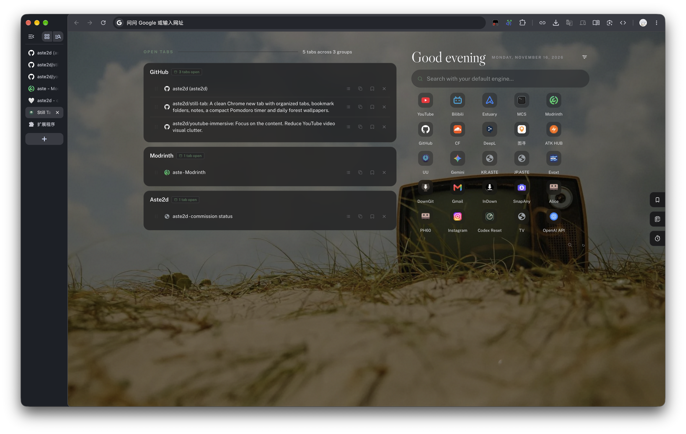

# Still Tab

[English](../README.md) · [简体中文](README.zh-CN.md) · [繁體中文](README.zh-TW.md) · [日本語](README.ja.md)

清爽的 Chrome 新标签页。左侧整理打开的标签页，右侧搜索和书签，旁边放好待办、笔记和番茄钟。主页没有品牌标识、广告或多余文案。

[反馈问题](https://github.com/aste2d/still-tab/issues) · [隐私政策](https://astab-privacy.poodle11215.chatgpt.site)

## 安装

需要 **Chrome 134 或更新版本**。点击**添加至 Chrome**并确认，然后打开一个新标签页。如果 Chrome 询问是否保留更改，选择保留。商店版由 Chrome 自动更新。

## 如果无法从 Chrome 应用商店安装

从 GitHub 手动安装

1. 从 [GitHub Releases](https://github.com/aste2d/still-tab/releases/latest) 下载 `still-tab-版本号.zip`。如需最新开发版，也可以[下载源码 ZIP](https://github.com/aste2d/still-tab/archive/refs/heads/main.zip)。两者都可直接加载，无需编译。
2. 解压到准备长期保留的文件夹。
3. 打开 `chrome://extensions`，开启**开发者模式**。
4. 点击**加载已解压的扩展程序**，选择直接包含 `manifest.json` 的文件夹。

更新手动安装版时，把新版文件覆盖到**原来的同一个文件夹**。在已有的 Still Tab（原名 astab）扩展上点击**重新加载**，然后刷新或重新打开新标签页。沿用同一文件夹可以保留扩展身份和本地数据。卸载会清除扩展的本地数据。Chrome 书签由浏览器单独管理。商店版的扩展 ID 不同，手动安装版的本地数据不会自动迁移。

## 功能

**默认开启「自动关闭多余的新标签页」。** 打开一个新标签页时，会关闭所有窗口中其他的新标签页，包括固定的新标签页。普通网页保持打开。需要多个新标签页时，可以在 Still Tab 的设置中关闭此选项。

- 标签页按网站分组。拖动卡片空白处或标题文字可以调整顺序，每个标签页都可单独复制标题。
- 书签保持 Chrome 原有顺序，支持浏览文件夹、返回上级和全局搜索。「显示所有书签」默认关闭，只显示书签栏。开启后可查看其余书签根目录。
- 右侧提供稍后阅读、待办、笔记和可收起的番茄钟。支持 25 分钟专注、5 或 15 分钟休息，以及暂停、继续和重置。
- 默认使用每日发现壁纸，也可选择八张精选 Unsplash 森林照片、自定义背景图片或纯色。离线时可继续使用已缓存的壁纸。
- 五种主题颜色可自选或随机生成。「默认」可恢复 Sage 配色。
- 悬停时显示「关闭分组」和「关闭所有标签页」。五秒内再次点击即可确认。移开鼠标、按 Escape 或执行其他操作可取消。

## 隐私与权限

Still Tab 无需账号，无广告、分析追踪或开发者运营的服务器。标签页、书签、保存的页面、笔记和计时状态在本地处理。使用在线壁纸时会联系图片提供方。搜索使用 Chrome 的默认搜索引擎，打开链接会正常连接目标网站。

`tabs` 用于显示和管理标签页，`bookmarks` 用于只读访问书签，`storage` 用于保存本地数据，`search` 用于使用默认搜索引擎，`favicon` 用于显示网站图标，`alarms` 用于在页面关闭后完成计时。

[隐私政策](https://astab-privacy.poodle11215.chatgpt.site)包含数据处理、网络连接、保留和删除的说明。也可以在扩展的「关于」页面查看随包附带的政策。

## 开发

项目使用原生 JavaScript、HTML 和 CSS。测试、生成图标和打包的命令见[开发说明](../README.md#development)。

## 致谢和许可

Still Tab 由 aste2d 在 [Tab Harbor](https://github.com/V-IOLE-T/tab-harbor) 基础上修改并重新命名，沿用 [MIT 许可证](../LICENSE)。原项目版权 © 2026 Han Zheng。Public Sans 和 Libre Caslon Display 按各自随附的 SIL 开源字体许可证分发。森林壁纸的来源记录在 [forest-library.js](../src/forest-library.js) 中，每日发现使用 [Lorem Picsum](https://picsum.photos/)。
