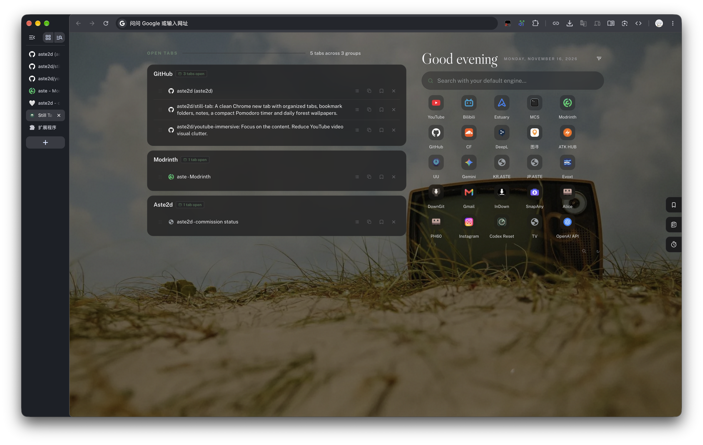

# Still Tab

[English](../README.md) · [简体中文](README.zh-CN.md) · [繁體中文](README.zh-TW.md) · [日本語](README.ja.md)

簡潔的 Chrome 新分頁。左側整理開啟的分頁，右側提供搜尋和書籤，側邊收納待辦事項、筆記和番茄鐘。

**[從 Chrome 線上應用程式商店安裝](https://chromewebstore.google.com/detail/still-tab/ifdkabkkiadgmdpbaijgcmcaeledkdci)** · [回報問題](https://github.com/aste2d/still-tab/issues) · [隱私權政策](https://astab-privacy.poodle11215.chatgpt.site)

## 安裝

需要 **Chrome 134 或更新版本**。開啟 [Chrome 線上應用程式商店頁面](https://chromewebstore.google.com/detail/still-tab/ifdkabkkiadgmdpbaijgcmcaeledkdci)，按一下**加到 Chrome**並確認。接著開啟新分頁。如果 Chrome 詢問是否保留新分頁的變更，請選擇保留。商店版由 Chrome 自動更新。

**預設開啟「自動關閉多餘的新分頁」。** 開啟新分頁時，所有視窗中其他的新分頁會關閉，包括已釘選的新分頁。一般網頁會保持開啟。若想保留多個新分頁，可在 Still Tab 的設定中關閉此選項。

### 從 GitHub 手動安裝

1. 從 [GitHub Releases](https://github.com/aste2d/still-tab/releases/latest) 下載 `still-tab-版本號.zip`。若要使用最新開發版，也可[下載原始碼 ZIP](https://github.com/aste2d/still-tab/archive/refs/heads/main.zip)。兩者都可直接載入，無須編譯。
2. 解壓縮到打算長期保留的資料夾。
3. 開啟 `chrome://extensions`，啟用**開發人員模式**。
4. 按一下**載入未封裝項目**，選擇直接包含 `manifest.json` 的資料夾。

更新手動安裝版時，把新版檔案覆蓋到**原本的同一個資料夾**。在現有的 Still Tab（原名 astab）擴充功能上按一下**重新載入**，再重新整理或重新開啟新分頁。沿用同一個資料夾可保留擴充功能的識別碼及本機資料。移除擴充功能會清除其本機資料。Chrome 書籤由瀏覽器另外管理。商店版使用不同的擴充功能識別碼，手動安裝版的本機資料不會自動移轉。

## 功能

- 分頁按網站分組。拖曳卡片空白處或標題文字可調整順序，也可個別複製分頁標題。
- 書籤保留 Chrome 原有順序，支援瀏覽資料夾、返回上層和跨資料夾搜尋。「顯示所有書籤」預設關閉，只顯示書籤列。開啟後可查看其餘書籤根目錄。
- 右側提供稍後閱讀、待辦、筆記和可收合的番茄鐘。支援 25 分鐘專注、5 或 15 分鐘休息，以及暫停、繼續和重設。
- 預設使用每日探索桌布，也可選擇八張 Unsplash 森林照片、自訂背景圖片或純色。離線時可繼續使用快取的桌布。
- 五個主題色可以自訂或隨機產生。選擇「預設」可還原 Sage 配色。
- 滑鼠移到區域上方時，會顯示「關閉群組」和「關閉所有分頁」。五秒內再按一次即可確認。移開滑鼠、按 Escape 或執行其他操作可取消。

## 隱私權與權限

Still Tab 無須帳號，也沒有廣告、分析追蹤或開發者營運的伺服器。分頁、書籤、已儲存頁面、筆記和計時狀態均在本機處理。線上桌布會向圖片供應商發出請求。搜尋使用 Chrome 的預設搜尋引擎，連結會正常開啟目標網站。

`tabs` 用於顯示及管理分頁，`bookmarks` 用於唯讀存取書籤，`storage` 用於儲存本機資料，`search` 用於使用預設搜尋引擎，`favicon` 用於顯示網站圖示，`alarms` 用於在頁面關閉後完成計時。

[隱私權政策](https://astab-privacy.poodle11215.chatgpt.site)說明資料處理、網路連線、保留及刪除方式。也可從擴充功能的「關於」頁面閱讀隨附的政策。

## 開發

專案使用原生 JavaScript、HTML 和 CSS。測試、產生圖示與打包指令見[開發說明](../README.md#development)。

## 致謝與授權

Still Tab 由 aste2d 在 [Tab Harbor](https://github.com/V-IOLE-T/tab-harbor) 基礎上修改並重新命名，採用 [MIT 授權](../LICENSE)。原始專案版權 © 2026 Han Zheng。Public Sans 和 Libre Caslon Display 依各自隨附的 SIL 開放字型授權散布。森林桌布來源記錄於 [forest-library.js](../src/forest-library.js)，每日探索使用 [Lorem Picsum](https://picsum.photos/)。
